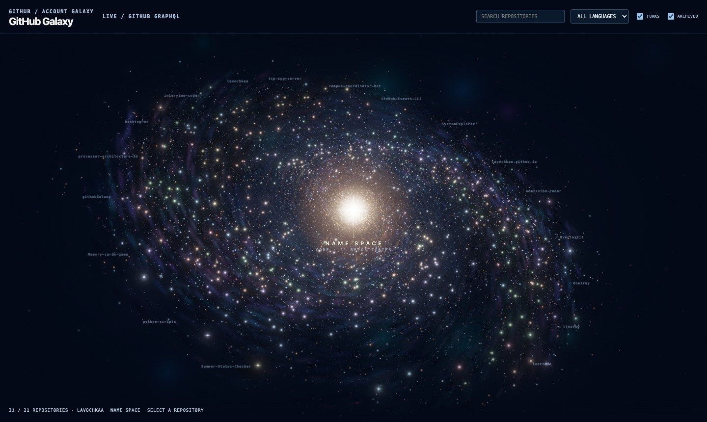
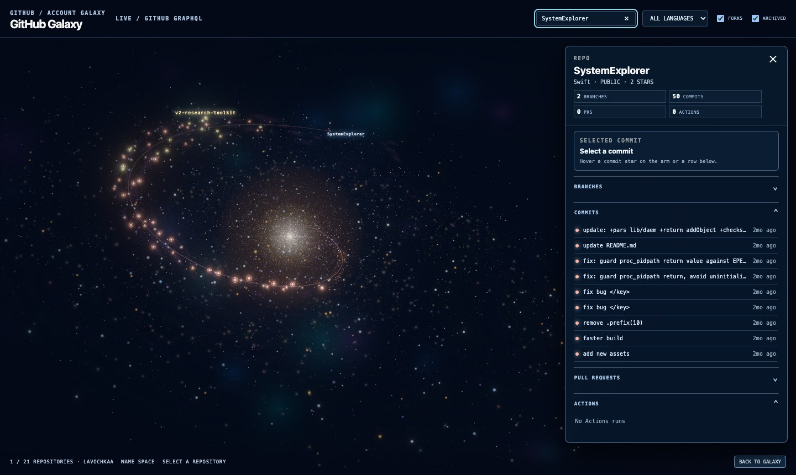

<h1 align="center">GitHub Galaxy</h1>

[](https://github.com/lavochkaa/githubGalaxy/actions/workflows/ci.yml)
[](LICENSE)


**Your GitHub account as a living spiral galaxy.** Each repository is a spiral arm, each commit is a star on that arm,
and the whole disc turns slowly around you at the core. A local, read-only, zero-dependency tool: one Python file serves
the data, one WebGL page draws it.

https://github.com/user-attachments/assets/dfeddfe9-8698-45d1-9019-76ce550474e7


Click an arm and its history lights up: branches run as parallel strands, merges glow brighter, HEAD carries a
diffraction glint, and GitHub Actions runs pulse as rings around the commits they built.

| Overview | Repository drill-down |
| --- | --- |
|  |  |

## Highlights

- **Nothing hardcoded.** The galaxy is built from the account at runtime; new repositories appear on the next refresh.
- **Commits as stars.** Newest at the rim, oldest near the core, sized by diff size.
- **Repository drill-down.** Up to 200 commits, branches, pull requests and Actions runs, synced both ways between
  the scene and the side panel.
- **Fast on the GPU.** About 25k stars, gas filaments, dust lanes, a warm bulge and a stellar halo, with HDR bloom and
  tone mapping in Three.js shaders.
- **Safe by design.** Local, read-only, and the token never reaches the browser (see [Security model](#security-model)).
- **Gentle on rate limits.** Responses are cached on disk and refreshed in the background, so restarts cost nothing.

## Quick start

Requires Python 3.10+ and a browser with WebGL 2. No packages to install, no build step.

```sh
git clone https://github.com/lavochkaa/githubGalaxy.git
cd githubGalaxy
python3 server.py --owner <your-github-login>
```

Open <http://127.0.0.1:8765/>.

Without a token the public REST API is used: public repositories only, 60 requests per hour.

## Using a token (recommended)

A token adds private repositories, switches to GraphQL and raises the limit to 5,000 requests per hour.

1. Open **GitHub → Settings → Developer settings → Fine-grained tokens → Generate new token**.
2. Set **Repository access** to **All repositories**.
3. Grant **Read-only** access to: Contents, Metadata, Pull requests, Actions.
4. Save the token in a file only you can read:

   ```sh
   mkdir -p ~/.config/github-galaxy
   read -rs "TOKEN?GitHub token: " && printf %s "$TOKEN" > ~/.config/github-galaxy/token && unset TOKEN
   chmod 600 ~/.config/github-galaxy/token
   ```

   In bash, use `read -rsp "GitHub token: " TOKEN` instead.

5. Start the server. With a token, `--owner` is optional and defaults to the token's account.

   ```sh
   GITHUB_TOKEN_FILE=~/.config/github-galaxy/token python3 server.py
   ```

If GitHub is unreachable or the token is rejected, the page falls back to a generated galaxy. It is clearly labelled
**SIMULATED DATA, NOT YOUR REPOSITORIES** in the header, with the reason on hover.

## Configuration

| Setting | Default | Purpose |
| --- | --- | --- |
| `--owner` / `GITHUB_OWNER` | token's account | User or organization to render |
| `--host` | `127.0.0.1` | Interface to bind |
| `--port` | `8765` | Port to listen on |
| `GITHUB_TOKEN_FILE` | none | Path to a token file; must be mode `0600` |
| `GITHUB_TOKEN` / `GH_TOKEN` | none | Token from the environment |
| `GITHUB_GALAXY_CACHE` | `~/.cache/github-galaxy/cache.json` | Disk cache location |

**Cache freshness:** inventory 5 minutes, repository detail 90 seconds, per-repository commit history 1 hour.
Expired entries are served immediately and refreshed in the background; entries older than a week are discarded.

## Controls

| Action | Input |
| --- | --- |
| Orbit | Drag |
| Pan | Shift + drag, or right-drag |
| Zoom | Alt/Ctrl/⌘ + scroll, or `+` / `-` |
| Select a repository | Click its arm, or search and press Enter |
| Inspect a commit | Hover or click a star, or a row in the panel |
| Back to the galaxy | `Esc` or **Back to galaxy** |

Hovering anywhere on the disc picks the nearest arm. The header has search, a language filter and fork/archived toggles.
Append `?bloom=force` to keep the glow pass on slow GPUs; it otherwise switches off automatically when frames get slow.

## How it works

```
browser (web/)                          server.py                   GitHub
 galaxy.js ─ interaction, panel ──▶  /api/github-galaxy         ─▶ GraphQL (token)
 galaxy_gpu.js ─ shader layers       /api/github-galaxy/repo    ─▶ REST (public fallback)
 galaxy_arm_layout.mjs ─ arm math    /api/github-galaxy/head
 space_renderer.js ─ HDR + bloom     github_galaxy_data.py ─ validation, cache
```

- **Arms** are logarithmic spirals sharing one pitch and phase origin, so they stay evenly interleaved. A two-armed
  density wave brightens broad bands across them for the grand-design look. The pattern rotates rigidly, so the arms
  never wind up.
- **One arm function, two implementations.** It exists in JavaScript (`galaxy_arm_layout.mjs`) and in GLSL
  (`galaxy_gpu.js`). The GPU moves every particle; the CPU evaluates the same function only for picking and labels, so
  hover targets always match what is drawn.
- **Rendering** goes into a half-float target, then a soft-threshold extract, a five-level bloom mip chain,
  exponential tone mapping, sRGB output and dithering.

## Security model

- The server binds to `127.0.0.1` by default and exposes three read-only `GET` routes.
- The token stays server-side. A token file must be mode `0600`, and the disk cache is written with `0600` too.
- Owner and repository names are validated against a strict pattern before they reach any upstream URL.
- Static files are served only from `web/`; path traversal attempts return 404.
- Internal errors are logged on the server and never returned to the client. Only upstream GitHub failures surface,
  with a short authored message and a 502 status.
- The client escapes every value it renders and opens external links with `rel="noopener noreferrer"`.

If you bind to a non-loopback `--host`, remember that anyone who can reach the port can browse the repositories your
token can see.

## Project layout

```
server.py               local HTTP server and API routes
github_galaxy_data.py   GitHub GraphQL/REST client, validation, disk cache
web/                    static client, no build step
  index.html            page and styles
  galaxy.js             scene, camera, picking, labels, side panel
  galaxy_gpu.js         shader layers: stars, gas, dust lanes, bulge, commits
  galaxy_arm_layout.mjs arm geometry shared by CPU and GPU
  space_renderer.js     renderer, background nebulae, HDR bloom pipeline
  vendor/               Three.js r186 (MIT)
tests/                  Python unittest and Node assertion scripts
```

## Development

```sh
python3 -m unittest discover -s tests          # Python tests
for test in tests/*.mjs; do node "$test"; done  # JavaScript tests
python3 -m pip install ruff && ruff check .     # lint, same as CI
```

CI runs all three on every push and pull request.

## License

MIT, see [LICENSE](LICENSE). Three.js is bundled under its own MIT license in
[`web/vendor/THREE-LICENSE.txt`](web/vendor/THREE-LICENSE.txt).
